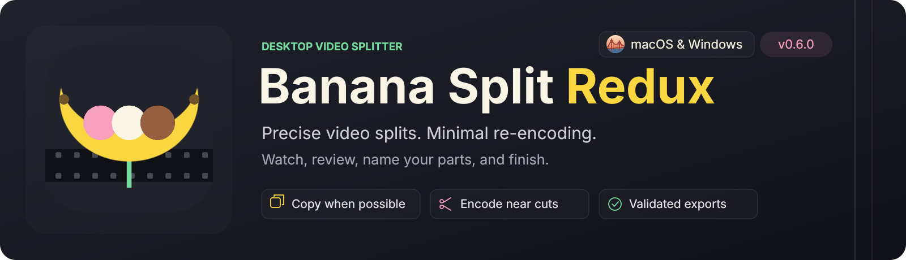

[](https://github.com/dustalexw/Banana-Split-Redux/releases/tag/v0.6.0)
[](https://github.com/dustalexw/Banana-Split-Redux/releases/tag/v0.6.0)
[](#run-it-on-your-mac)

# Banana Split Redux 0.6.0

Split animated-series video files at reviewed black transitions, **without re-encoding**
wherever a clean cut is possible, and with every output independently checked.

Import → detect black intervals → review proposed cuts → choose preservation mode →
review the export plan → export and validate.

## Updated in 0.6.0 — Banana Split Redux for Windows

Banana Split Redux now runs on **Windows 10 and 11 (64-bit)** with every feature of the Mac app: detection
and review, the player, exact boundary re-encoding, black removal, validation, projects, segment
recommendations, Episode names with TMDB/TVDB lookup, and the command line. It looks the same: the
charcoal, banana-yellow, pink and mint theme, with a charcoal title bar that runs into the brand bar
(Windows 11; Windows 10 gets the dark title bar). Text uses Segoe UI.

- **Download:** `Banana-Split-Redux-0.6.0-windows-x64-setup.exe` installs per user (Start menu, optional
  desktop icon, *Open with* for video files, uninstaller). `Banana-Split-Redux-0.6.0-windows-x64.zip` is the
  portable version: unzip anywhere and run **Banana Split Redux.exe**. Python, Qt and FFmpeg are included.
  Neither is code-signed, so Windows SmartScreen may say it protected your PC: choose **More info → Run anyway**.
- **Shortcuts:** Alt+Enter keeps, Alt+Backspace skips, Alt+Left/Right moves between splits, Space plays.
- **Where things live:** caches in `%LOCALAPPDATA%\BananaSplitRedux\Cache`, logs (including `launch.log`)
  in `%LOCALAPPDATA%\BananaSplitRedux\Logs`. TMDB/TVDB keys go in Windows Credential Manager.
  Export work folders are hidden in Explorer, as they are on the Mac.
- Every release now ships both apps; the Windows tests and a packaged-app self-test run on GitHub's Windows machines.

## Updated in 0.5.0 — two- and three-segment episodes that match TVDB/TMDB

TVDB and TMDB list each story segment of shows such as SpongeBob, Rugrats or Dexter's Laboratory
as its own episode. One file that holds two segments therefore needs one split, and its parts
are `S01E01` and `S01E02`; the next file continues at `S01E03`.

- **Segments per file:** choose **Auto**, **1**, **2**, **3** or **4** beside Detection. **Auto** reads
  the file name: two episode numbers (`S01E01-E02`, `S01E01E02`, `1x01-02`) or two segment titles
  (`Show - S01E01 - Help Wanted - Reef Blower`) mean two segments. Otherwise it uses the last number
  you picked (2 to start).
- **One recommended split per break:** the card now recommends the black transition nearest each
  expected break: halfway for two segments, about one third and two thirds for three. Strong scene
  changes elsewhere, such as a black at halfway in a three-segment episode, are not recommended.
  Detection is more sensitive in each break window, as it was at halfway. Every recommendation is
  starred in the list and highlighted on the timeline. **Keep recommended** keeps them all;
  **Keep recommended splits in all** does it for every analysed episode. Each cut is still checked.
- **Episode names:** **Episode names…** (beside Suggest names, or **Episode names for all…** in the episode list) numbers every part across the whole season and names it
  `Show - S01E03 - Title` (Plex, Jellyfin and Kodi style). Numbering uses, strongest first: segment
  titles matched against the database, episode ranges in the file name, then season order. Files
  missing from the queue are skipped over, assuming they hold as many segments as their neighbours.
  Names that give each file's *first* episode (`E01`, `E03`, `E05` …) are recognised; you can choose
  either reading.
- **Optional TMDB or TVDB lookup:** fills in titles and checks counts, for example *Season 1: 40 parts
  for 41 database episodes · missing E17*. Save your own TMDB API key or Read Access Token, or TVDB v4
  key (and PIN), with **Keys…**; they go in the macOS keychain. Only the show name is sent; replies are
  cached for a week. Database runtimes can place the breaks (7 + 7 + 8 minutes instead of equal thirds).
- Kept splits stay kept when you change the segment count or preset, even if the new settings would
  not suggest them, and when you reopen a project. CLI: `--segments 3 --accept-recommended --episode-names
  [--numbering broadcast|database]`. Projects saved by 0.5.0 open in 0.5.0 or later.

## Updated in 0.4.6

- **Integrated title bar:** the charcoal brand bar now runs to the top of the window. The window buttons sit inside it beside the logo, with the yellow rule directly below, instead of under a separate light title bar. Drag the bar to move the window or double-click it to zoom. Full screen keeps the regular layout.

## Updated in 0.4.5

- **Midpoint recommendation:** a mint card shows the black transition closest to halfway within the middle 40–60% of the video. **Review midpoint** opens it for inspection; a star in the split list and a highlighted timeline region make it easy to find. Keep or skip it after reviewing.
- **More sensitive near halfway:** new presets allow a single black frame in that region, with no minimum duration, a slightly higher darkness threshold (+2.5 percentage points), and up to 3 percentage points fewer dark pixels (95% with Balanced). Detection outside that region keeps the preset's thresholds and minimums. The best midpoint option remains visible alongside stronger nearby suggestions.
- Open detection settings to turn **More sensitive near halfway** off for a file. Changing it uses cached analysis. Saved projects retain the switch; older projects preserve their existing detection settings until you enable it or choose a new preset.

## Download

From the [0.6.0 release](https://github.com/dustalexw/Banana-Split-Redux/releases/tag/v0.6.0):

- **Mac:** **Banana-Split-Redux-0.6.0-macos-arm64.zip**. Unzip it and double-click **Banana Split Redux.app**
  (Apple-silicon Macs, macOS 14 or later). See the launch notes below for Gatekeeper.
- **Windows:** **Banana-Split-Redux-0.6.0-windows-x64-setup.exe** (installer) or
  **Banana-Split-Redux-0.6.0-windows-x64.zip** (portable). Windows 10 or 11, 64-bit. See
  [Run it on Windows](#run-it-on-windows).

Both are self-contained; Python and FFmpeg are included.

## Updated in 0.4.4

- **Review several splits at once:** click the first split, hold **Shift** and click the last. Use **Keep selected** or **Skip selected** to decide on the range.
- Selection stays in place while cuts are checked. **Undo** restores the entire batch, including its selection. Manual splits can be selected too.
- Keeping a batch still checks each boundary; any cut marked **Needs review** must be resolved before export.

## Updated in 0.4.3

- Simplified the app header to its icon and name. Removed the tagline and numbered Import / Review / Split text, with a shorter, vertically aligned banner.

## Updated in 0.4.2

- Preserves audible audio that begins before the first video frame in MP4/MOV. A shared timeline shift prevents MP4 edit lists from discarding it as encoder padding; genuine encoder priming is retained.
- Subtitles and chapters receive the same timeline shift as video/audio. Validation recognizes only provably blank, container-generated subtitle padding and still checks every planned cue and its timing.
- Reads from the beginning without a seek when early audio or captions must be preserved.

## Updated in 0.4.1

- Xvid/MPEG-4 cuts preserve the decoder delay across tiny encoded joins, preventing a missing or repeated frame.
- HEVC exports restore original decoder settings at copied keyframes for reliable backward seeking after encoded joins.
- Finish job stays available after analysis. Any unresolved cut or part that is too short shows a visible reason and **Review split** opens the relevant split.
- Failed or cancelled exports return to Ready so you can finish again.

## Updated in 0.4.0

- **Video player with sound:** watch the full source, scrub, jump five seconds,
  change speed/volume, choose playback audio/subtitles, and expand the player.
  Space plays/pauses when the player has focus. **Preview this split** plays a
  four-second window around the selected split, with optional looping.
- **Faster review:** adding/dropping videos in the interface starts detection.
  The first suggestion opens automatically. **Keep & next**, **Skip & next**,
  **Next to review**, **Keep all shown**, and **Undo** reduce repeated navigation.
  Option+Return keeps; Option+Backspace skips; Option+Left/Right navigates (Alt on Windows).
- **Easy adjustment:** enter `HH:MM:SS.mmm` (or seconds), use the playhead for the
  selected split, or add a new split. Open **Frame preview & advanced options**
  for exact source frames, frame stepping, black removal and boundary details.
- **Title suggestions:** **Suggest names…** separates show/episode metadata from
  titles separated by spaced hyphens/en dashes/em dashes, semicolons, underscores
  or vertical bars. Hyphens inside words such as Spider-Man stay intact. Matching
  title/part counts suggest names in order; mismatches preserve your current names
  until you assign titles, including optional Intro/Credits. Every name stays editable.
- **Finish job…** reviews the cut plan before export. Results include **Play part**
  and **Open output folder**. **Output settings** contains folder, tracks, mode and quality.

The playback-only MPEG/TS cache copies compressed video/audio into an indexed MKV
for dependable seeking, outside source folders. AV1 video uses PyAV software decoding
with Qt's audio clock; 10-bit CPU display has a mapped-plane conversion fallback.
These playback paths do not affect export codecs, cut positions or preservation rules.
The first MPEG/TS preview may take time and disk space approximately equal to the source.
Cached playback files live under `~/Library/Caches/BananaSplitRedux/playback` and can
be removed when the app is closed. Original videos remain read-only.

Examples: `Show - S01E01 - First - Second.mp4` suggests `Show - S01E01 - 01 First`
and `Show - S01E01 - 02 Second`; `Show (2002) - S01E04 - First_Second[1080p].mp4`
works too. Filename guesses do not identify the content; confirm order against the video.

## Updated in 0.3.1

Open **Banana Split Redux → About Banana Split Redux…** on macOS for the branded
About window and version. On other desktops, use **Help → About Banana Split Redux…**.
The macOS application menu now uses the app name instead of `main.py`: startup
sets the Qt identity and branded argument before constructing the native interface.

## Updated in 0.3.0

The exact-cut mode now supports H.264, HEVC 8/10-bit, MPEG-2, MPEG-4, VP8, VP9,
AV1, WMV2 and FFV1 within the tested pixel-format matrix. AVI, MKV, MP4/M4V, MOV,
WebM, MPEG/MPG, TS and FLV are covered by actual generated-file workflows; WMV/ASF
is covered with WMV2 video. MJPEG and ProRes have safe per-frame copy cuts.

Import, analysis, previews, review/project restore, strict cuts, exact cuts, black
removal and independent export validation are exercised across the format matrix.
The desktop mode is tested as selectable on every matrix input. Sources stay read-only.
AVI B-frame timing is recovered from decoded frame order, without changing picture data.
Black removal can now encode both edges exactly when copy boundaries are unavailable.
Closely spaced cuts sharing a GOP retain every planned frame exactly once.

The interface follows the existing icon: charcoal, banana yellow, strawberry pink,
cream and mint. [The support matrix](docs/SUPPORT_MATRIX.md) records verified variants
and exceptions, including HDR and bitmap subtitles.

## Run it on your Mac

**`Banana Split Redux.app`** (delivered alongside this updated source archive) is self-contained: it
carries its own Python 3.12, the FFmpeg libraries (inside PyAV), Qt 6 and NumPy. Nothing
else needs to be installed. Requirements: Apple-silicon Mac, macOS 14 or newer, ~390 MB.

- Double-click it, or drag it to **Applications** first. The bundle is not signed by Apple
  (no developer ID): if macOS says it can't verify the developer, right-click → **Open** once.
- Add files with drag-and-drop onto the app window or the *Add…* button.
- If it ever fails to start, it shows an alert; details are in
  `~/Library/Logs/BananaSplitRedux/launch.log`.

Rebuilding the app (from this folder; runs on macOS or Linux, downloads the pinned runtime
listed in `packaging/macos-lock.txt` and records SHA-256 hashes in the bundle):

```bash
python3 packaging/build_macos_app.py --out dist
```

Copy the result to a new location rather than overwriting an existing bundle in place:
macOS kills apps whose signed binaries were modified in place (exit 137), even if the bytes
are identical.

Developer alternative (needs Python 3.10+): double-click `Banana Split Redux.command`, which
creates a `.venv` and runs the same code; `./bsr-cli` runs the command-line engine.

## Run it on Windows

**`Banana Split Redux.exe`** carries its own Python 3.12, FFmpeg (inside PyAV) and Qt 6; nothing else
needs to be installed. Requirements: Windows 10 (1809 or later) or Windows 11, 64-bit, about 450 MB.

- Run the **setup** for a Start-menu entry and *Open with* support, or unzip the **portable** zip anywhere.
  The app is not code-signed: if SmartScreen appears, choose **More info → Run anyway** once.
- Add files with drag-and-drop from Explorer onto the window, or with *Add…*.
- If it ever fails to start, it shows a message; details are in
  `%LOCALAPPDATA%\BananaSplitRedux\Logs\launch.log`.
- Keyboard: Alt+Enter keeps a split, Alt+Backspace skips, Alt+Left/Right navigates.

Building it (on Windows, with Python 3.12):

```bat
py -3.12 -m venv .venv-win
.venv-win\Scripts\pip install -r packaging\windows-lock.txt
.venv-win\Scripts\python packaging\build_windows_app.py --out dist-win
```

This writes the app folder, the portable zip and, with [Inno Setup 6](https://jrsoftware.org/isinfo.php)
installed, the setup. `"Banana Split Redux.exe" --self-test report.txt` checks a build without opening a
window. The **Windows** GitHub workflow runs the test suite and this build on every change.

Developer alternative: double-click `Banana Split Redux.bat` (creates `.venv-win` and runs the
source); `bsr-cli.bat` runs the command-line engine.

## Using the app

1. **Add** episodes (drag them onto the window, or *Add…*) to start detection. Use **Find split points** to scan again. Each frame is
   decoded for analysis; only the boundary frames are decoded again if re-encoding is needed. Results are cached in
   `~/Library/Caches/BananaSplitRedux`, keyed by file fingerprint, settings and library versions.
2. Pick a **Detection** preset — *Conservative*, *Balanced* (default), *Sensitive*,
   *Single-frame* — or open **Settings** for darkness threshold, % dark pixels (lower it to
   tolerate logos such as a channel bug), minimum frames/duration, spacing, and an
   analysis-only crop for letterboxing (*Show analysis region* draws it on the preview).
3. Review candidates in the list or on the timeline. For each one you see the frames around
   the black interval and the planned cut, a frame strip (black frames, keyframes, verified copy
   boundaries), frame stepping and a silent ±2 s preview. **Keep & next** or **Skip & next**; choose where
   in the black to split (start / middle / end); optionally **Remove black** with padding to keep.
4. Status labels:
   - **Copied** — a copy-safe cut exists inside the black and was proven by decoding.
   - **Copied (drops black frames)** — open-GOP source: the cut drops a few undecodable
     *black* frames. Needs your acceptance, or set a tolerance in Settings.
   - **Needs review** — strict mode, an unsupported format, or a cut that cannot be safely resolved. You choose: a nearby copy cut
     (the time difference and what moves between files are shown; nothing is deleted),
     **boundary re-encoding** (if supported), or skip. The exact amount of re-encoding is shown before export; outside-black copy cuts require your choice.
   - **Boundary re-encoding** — exact cut; only frames up to the nearest clean keyframe are re-encoded.
5. **Output parts**: edit file names (or *Names from file title…*), choose the output folder and
   tracks, then **Review & Export…**. The plan dialog lists every part, every track's treatment,
   removed content and the encoding scope (estimated re-encoded frames/seconds; audio is never
   re-encoded). After export, the results show every validation check and the *measured*
   re-encoding per part. A JSON report is written next to the outputs.
6. *File → Save Project* stores your decisions; *View → Diagnostic Log* shows everything
   (also in `~/Library/Logs/BananaSplitRedux/bsr.log`).

Modes: **Re-encode near cuts when needed** is the desktop default for supported
new imports. Safe boundaries are copied. Otherwise only the required boundary
frames are encoded using the source codec. The nearest usable keyframe can be
several seconds away; review the displayed scope before export. **No re-encoding
(strict)** creates no encoder and requires reviewed, verified copy boundaries.
Older projects and the CLI retain their strict default. Unsupported variants show
an explanation beside the mode controls. Full re-encoding is not implemented.

MKV, MP4/M4V, MOV and WMV keep their container family. AVI, WebM, MPEG/TS and FLV
export to preservation-friendly MKV. This changes container framing, never the
copied compressed pictures/audio. A shared start-time shift may keep early audio
packets at nonnegative timestamps while preserving their offset from the picture.


## Safety guarantees

- Sources are opened read-only; an export refuses to write over a source file.
- Outputs are written to a hidden `.bsr-partial-*` folder, validated, then moved into place.
  A part that fails validation stays there as `FAILED-…` and is reported as failed.
- Copy mode creates no encoder (tested). Copied compressed payloads are verified against the source,
  with container framing normalized for comparison. Smart joins may restore original decoder headers;
  these edits and any common timestamp shift are recorded separately.
- Validation of every output: track set and properties (codec, size, field order, colour,
  language, title, disposition), packet payloads, timestamps, full decode, frame count and
  order, first/last frame identity, seeking, audio decode and A/V offset, subtitles,
  chapters, attachments; joins and PSNR for boundary re-encoding.

## Architecture

| Module | Role |
|---|---|
| `bsr/media.py` | Probing, packet indexing and AVI B-frame presentation recovery |
| `bsr/detect.py` | Black analysis: per-frame dark-pixel fractions on a threshold grid (range/bit-depth aware), candidates, presets, optional audio level |
| `bsr/boundaries.py` | Keyframe structure (open GOP, leading/trailing pictures, IDR parsing) and decode **proofs** of copy-safe cut points |
| `bsr/planner.py` | Your decisions → resolved cuts → half-open segments on the integer video timeline |
| `bsr/export.py` | Packet-exact copy plus optional boundary pieces, subtitle clipping, chapters, attachments, atomic finalisation |
| `bsr/smart.py` | Codec-preserving boundary encoding and decoder-header restoration |
| `bsr/validate.py` | Independent output validation |
| `bsr/session.py`, `bsr/cli.py` | Per-file state, projects, command line |
| `bsr_ui/` | PySide6 desktop interface (all media work in background threads) |

Stack: Python + **PyAV** (FFmpeg libraries, bundled in the wheel, so builds are reproducible
and don't depend on whichever FFmpeg is installed) + NumPy + **PySide6/Qt 6** (native macOS
widgets, drag and drop, threads). The engine is portable (tested on Linux x86-64 and arm64).

## Version history

This repository preserves the original development history and includes the verified
0.4.3 app source, tests, icon and repeatable macOS build. Episode files, generated
fixtures, caches and app bundles are excluded from Git. Packaged apps are supplied
as release downloads.

## Tests

```bash
.venv/bin/python -m pip install pytest
.venv/bin/python -m pytest tests            # generates fixtures on first run
QT_QPA_PLATFORM=offscreen .venv/bin/python tests/ui_smoke.py FILE OUTDIR [SHOTS] [--accept-drops|--smart]
```

Fixtures (`tests/fixturegen.py`, generated with PyAV's own encoders) have numbered frames,
known black intervals (hard cut, single-frame flash, fade, logo-on-black), a dark scene that
must not be detected, letterboxing, 10-bit, VFR with a 10 s start offset, closed/open/long
GOPs, B-frames, MPEG-2 open GOP, MBAFF interlaced H.264 with 12:11 SAR, AC-3 + AAC tracks,
ASS subtitles crossing cuts, a font attachment, chapters, and audio sync beeps every second.

See [docs/VERIFICATION.md](docs/VERIFICATION.md) for what has been verified on your real
episodes and what has not.
